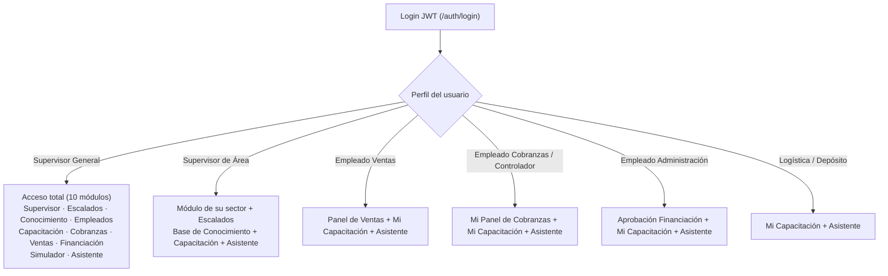

<div align="center">


# TrimIA — Frontend

**Panel operativo, de supervisión IA y capacitación corporativa para la plataforma TrimIA**

[](https://react.dev/)
[](https://vite.dev/)
[](https://oxc.rs/)
[](https://www.cypress.io/)
[](https://vercel.com/)

[Módulos del Panel](#-módulos-y-vistas-del-panel) · [Control de Acceso](#-control-de-acceso-por-rol-rbac) · [Clone & Run (Devs e IA)](#-guía-de-arranque-rápido-devs-y-agentes-de-ia) · [Testing E2E](#-testing-e2e-y-verificación) · [Repositorio Backend](https://github.com/mauroarmas/TrimIA-Backend)

</div>

---

## 🎯 Sobre el proyecto

**TrimIA Frontend** es la interfaz web SPA de la plataforma **TrimIA** (desarrollada para **Credimisión S.R.L.** como Proyecto Final de Ingeniería en Sistemas). Conecta empleados, supervisores de área y gerencia con el ecosistema multi-agente de IA del backend en tiempo real.

Construido con **React 19 + Vite 8** sin dependencias pesadas de UI, con sistema de diseño propio en CSS (soporte **modo claro / oscuro**), autenticación exclusivamente por **JWT** (sin secretos compartidos en el navegador), streaming en vivo por **Server-Sent Events (SSE)** y cobertura E2E con **Cypress**.

> **Repositorio hermano (API NestJS + LangGraph + RAG):** [mauroarmas/TrimIA-Backend](https://github.com/mauroarmas/TrimIA-Backend)

---

## ✨ Módulos y vistas del panel

| Ruta (`/panel/...`) | Módulo | Qué permite operar |
|---|---|---|
| `/panel/supervisor` | **Panel del Supervisor** | Tablero de gobernanza: estado de los 5 agentes IA, métricas de rendimiento, economía de tokens, selector de modelo IA, historial completo de conversaciones e intervención en vivo. |
| `/panel/escalados` | **Casos Escalados (HITL)** | Cola priorizada por pertenencia de área (`PROPIA` / `SIN_AREA` / `AJENA`), toma de conversación (`takeover`), redacción asistida por IA con score de respaldo visible, corrección directa de la base de conocimiento y derivación. |
| `/panel/conocimiento` | **Base de Conocimiento y Mejoras** | Carga de texto y archivos multimodales (PDF, Word, imágenes, audio), CRUD versionado, detección de duplicados/parecidos, barrido de higiene con fusión asistida, lista unificada de mejoras y **entrevistas conversacionales** desde el tráfico real. |
| `/panel/ventas` | **Panel de Ventas** | Gestión de prospectos y sincronización CRM, consulta de stock, evaluación crediticia, seguimiento comercial automático, cierres de órdenes financiadas y alta de planes de cuotas. |
| `/panel/financiacion` | **Aprobación Financiación** | Bandeja administrativa (`Pendientes`, `Aprobadas`, `Rechazadas`, `Canceladas`) para revisar solicitudes de venta financiada con control de versión optimista (`409 Conflict` seguro). |
| `/panel/cobranzas` | **Panel de Cobranzas** | Revisión de comprobantes con lectura asistida por Gemini Vision, verificación de impacto bancario (Cobrador Controlador), cuenta corriente de clientes, recordatorios y timeline de actividad. |
| `/panel/capacitacion` | **Capacitación y Diagnóstico** | Diagnóstico inicial por área, generación y estudio de píldoras, reproducción de **píldoras en audio TTS**, simulaciones interactivas de roleplay con feedback y seguimiento por empleado. |
| `/panel/empleados` | **Empleados y Áreas** | Alta, edición, desactivación y asignación N:M de áreas supervisadas. |
| `/panel/asistente` | **Chat con el Asistente** | Chat interno en tiempo real (SSE) contra los agentes corporativos con exportación de conversaciones. |
| `/panel/simulador` | **Simulador de Chat** | Simulación autenticada de clientes externos para probar flujos comerciales y escalamientos sin depender de WhatsApp. |

---

## 🔐 Control de acceso por rol (RBAC)

La navegación y vistas visibles se adaptan automáticamente al perfil autenticado vía `POST /auth/login`:



---

## 🛠️ Decisiones técnicas destacadas

- **Cliente HTTP único y tipado por contrato (`src/api.js`):** Centraliza todas las llamadas REST/FormData/SSE, maneja expiración de sesión (`trimia:session-ended` ante `401`) y preserva el cuerpo de error en `ApiError` (`status`, `body`, `reason`) para distinguir acciones exactas en la UI (por ejemplo `409` con `currentVersion` o `413` entre `MULTIMODAL_LIMIT` y `FILE_LIMIT`).
- **Seguridad en el cliente:** Nunca se exponen API keys de Gemini, secretos JWT ni tokens de Meta en variables `VITE_*`. Los builds de producción fallan explícitamente en `vite.config.js` si `VITE_API_BASE_URL` no usa `HTTPS` (salvo en modo `VITE_SAME_ORIGIN=true`).
- **Routing SPA sin overhead (`src/router.js`):** Sincronización bidireccional con `window.history` para tabs y subtabs (`/panel/<modulo>/<submodulo>`), con soporte de deep-links y rewrite configurado en `vercel.json`.
- **Proxy de desarrollo transparente (`vite.config.js`):** En local, Vite proxea automáticamente todas las rutas del backend (`/auth`, `/supervisor`, `/knowledge`, `/sales`, `/collections`, `/training`, etc.) hacia `http://localhost:3000`.

---

## 🤖 Guía de arranque rápido (Devs y Agentes de IA)

Esta guía permite que **cualquier desarrollador o agente de IA** clone, conecte con el backend y levante el panel en menos de 2 minutos.

### 1. Prerrequisitos

- **Node.js 22+** y `npm`
- **Backend TrimIA levantado** en `http://localhost:3000` (ver [TrimIA-Backend](https://github.com/mauroarmas/TrimIA-Backend) — comprobar con `curl http://localhost:3000/health`).

### 2. Clonar, instalar y configurar entorno

> ⚠️ **Nota de rama:** La rama por defecto de este repositorio es **`master`** (no `main`).

```bash
git clone https://github.com/mauroarmas/trimia-frontend.git trimIA-frontend
cd trimIA-frontend
npm ci
cp .env.example .env
```

Contenido de `.env` para desarrollo local:

```env
# URL del backend local (opcional si usás el proxy por defecto de Vite hacia localhost:3000)
VITE_API_BASE_URL=http://localhost:3000
```

### 3. Levantar el servidor de desarrollo

```bash
npm run dev
```

Abrí **`http://localhost:5173`** en el navegador (HMR activo).

> **Credenciales de prueba (seed del backend):**
> - **Supervisor General (acceso total):** `diego.bazan@credimision.com` / `trimia2026`
> - **Supervisora de Cobranzas:** `silvia.rios@credimision.com` / `trimia2026`
> - **Ventas:** `laura.gomez@credimision.com` / `trimia2026`
> - **Cobranzas / Controladora:** `marisa.paz@credimision.com` / `trimia2026`
> - **Administración:** `graciela.medina@credimision.com` / `trimia2026`

### 4. Variables de entorno y gotchas de Build (Vite)

| Variable | Cuándo usarla | Regla en `vite.config.js` |
|---|---|---|
| `VITE_API_BASE_URL` | Desarrollo local o deploy en Vercel separado del backend | En `npm run build` (`production`), **debe comenzar con `https://`** (sin barra final) o el build falla a propósito. |
| `VITE_SAME_ORIGIN=true` | Cuando el panel compilado se sirve desde el mismo origen/gateway que la API (ej. `scripts/demo-local.sh` en el backend) | Requiere dejar `VITE_API_BASE_URL` y `VITE_API_BASE` **vacíos**. |
| `VITE_DEV_PROXY_TARGET` | Si el backend corre en otro puerto/host distinto de `http://localhost:3000` en dev | Default: `http://localhost:3000`. |

**Comandos exactos de build según destino:**

```bash
# Build para producción (Vercel / backend separado HTTPS)
VITE_API_BASE_URL=https://tu-backend.ejemplo.com npm run build

# Build para mismo origen (gateway local / Docker demo)
VITE_API_BASE_URL= VITE_API_BASE= VITE_SAME_ORIGIN=true npm run build
```

---

## 🧪 Testing E2E y verificación

El proyecto cuenta con linting rápido vía **Oxlint** y **7 suites E2E en Cypress** que prueban flujos reales de punta a punta contra el panel y la API.

### Verificación rápida (igual que CI en `.github/workflows/ci.yml`)

```bash
npm run lint
VITE_API_BASE_URL=https://api.example.invalid npm run build
```

### Pruebas End-to-End (Cypress)

> Por defecto, `cypress.config.js` apunta a `baseUrl: http://localhost:8080` (gateway demo) y `apiUrl: http://localhost:3000`. Si corrés contra `npm run dev` en el puerto `5173`, pasá `--config baseUrl=http://localhost:5173`.

```bash
# Modo headless contra gateway (:8080)
npm run cy:run

# Modo headless contra Vite dev server (:5173)
npx cypress run --config baseUrl=http://localhost:5173

# Modo interactivo (UI de Cypress)
npm run cy:open
```

**Cobertura de suites Cypress (`cypress/e2e/`):**
1. `01-autenticacion-y-roles.cy.js` — Login, logout, expiración y permisos RBAC
2. `02-cobranzas.cy.js` — Cuotas, comprobantes e impacto bancario
3. `03-venta-financiada-y-stock.cy.js` — Stock, crédito, venta financiada y aprobación
4. `04-escalados-y-conocimiento.cy.js` — Cola HITL, takeover y base de conocimiento
5. `05-capacitacion.cy.js` — Diagnóstico, píldoras, audio y simulaciones
6. `06-agentes-ia-y-orquestacion.cy.js` — Ruteo multi-agente y chat en tiempo real
7. `07-api-integracion-y-seguridad.cy.js` — Seguridad HTTP, contratos y autorización

---

## 🚀 Despliegue

Para publicar en **Vercel** conectado al backend productivo, seguí la guía detallada en [`DEPLOY.md`](DEPLOY.md).

---

## 📂 Estructura del repositorio

```text
trimIA-frontend/
├── public/                 # Logos, favicons y assets estáticos
├── src/
│   ├── api.js              # Cliente HTTP/FormData/SSE único + ApiError
│   ├── App.jsx             # Layout principal, RBAC, sidebar y tema claro/oscuro
│   ├── router.js           # Rutas /panel/<tab>/<subtab> y hook useSubtabRoute
│   ├── areas.js            # Catálogo de áreas/agentes
│   ├── statusBadge.js      # Mapeo consistente de estados a badges visuales
│   ├── tokenEconomics.js   # Estimación y formato de consumo/costos de tokens
│   ├── theme.css           # Tokens de diseño (light / dark)
│   └── components/         # ~50 componentes organizados por dominio operativo
│       ├── SupervisorPanel.jsx
│       ├── EscalationsQueue.jsx / EscalationTakeoverModal.jsx
│       ├── KnowledgeIngest.jsx / KnowledgeHygiene.jsx / Improvements.jsx / Interview.jsx
│       ├── SalesPanel.jsx / CommercialOrdersPanel.jsx / AdminFinancingPanel.jsx
│       ├── CollectionsPanel.jsx / ReminderConfig.jsx
│       ├── TrainingPanel.jsx / DiagnosticQuizModal.jsx / PillStudyModal.jsx / SimulationModal.jsx
│       ├── WebChat.jsx / ChatSimulator.jsx
│       └── EmployeesPanel.jsx / Login.jsx
├── cypress/
│   ├── e2e/                # 7 suites E2E de negocio e integración
│   └── fixtures/           # Datos de prueba
├── vite.config.js          # Configuración Vite + validaciones de build + proxy dev
├── vercel.json             # Build y rewrites SPA para Vercel
└── DEPLOY.md               # Guía de despliegue en Vercel
```

---

## 🧭 Mapa de contexto para agentes de IA

Si sos un agente de IA trabajando en este repositorio, tené en cuenta estas reglas antes de editar:

1. **JavaScript + JSX puro (sin TypeScript):** No agregues archivos `.ts`/`.tsx` ni configuraciones TS.
2. **Extender [`src/api.js`](src/api.js):** Toda nueva llamada al backend debe vivir ahí reutilizando `request()` y `ApiError` (no duplicar `fetch` sueltos en componentes ni aplastar `err.body`/`err.reason`).
3. **Respetar [`src/router.js`](src/router.js) y [`src/App.jsx`](src/App.jsx):** Cualquier módulo o subtab nuevo debe registrarse en `TAB_TO_SLUG` / `SUBTAB_TO_SLUG` y respetar la matriz de visibilidad por rol en `App.jsx`.
4. **Distinciones del backend que la UI no debe aplastar:** Por ejemplo, `hasData: false` no equivale a `0`, y códigos HTTP repetidos (`409`, `413`) traen `reason` / `currentVersion` que determinan la acción ofrecida al usuario.
5. **Verificación obligatoria antes de cerrar una tarea:** Correr `npm run lint` y `VITE_API_BASE_URL=https://api.example.invalid npm run build`.

---

<div align="center">

Desarrollado como Proyecto Final de Ingeniería en Sistemas · **TrimIA**

</div>
